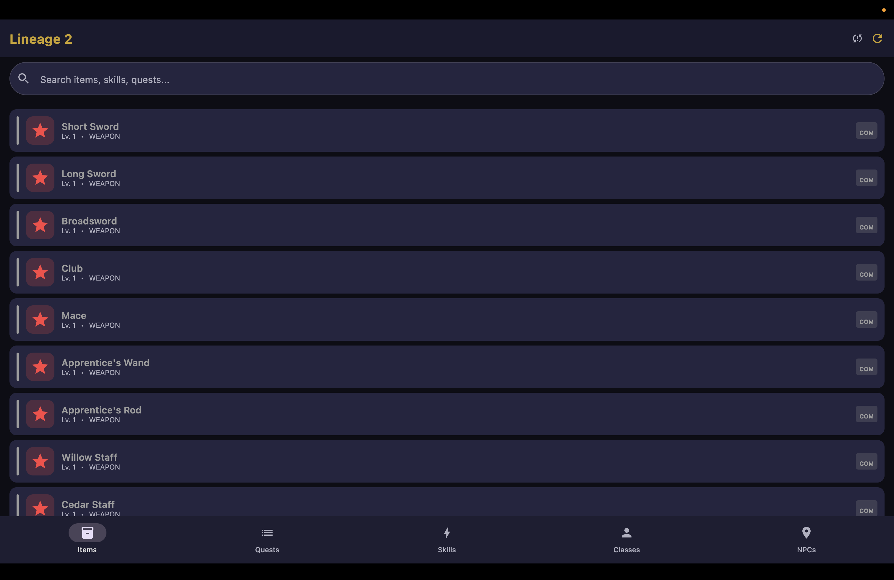
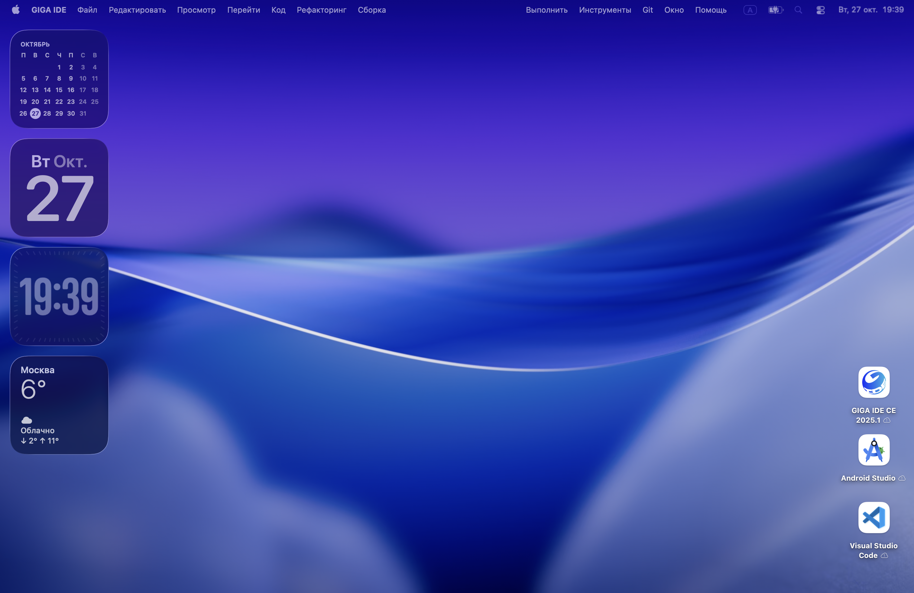
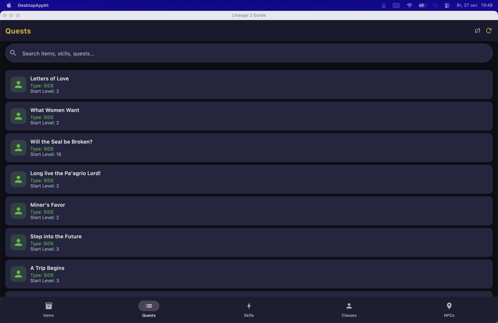
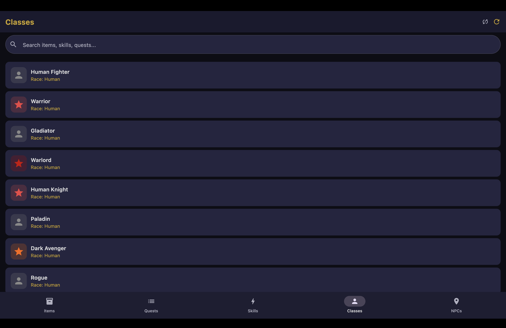

# Lineage 2 Guide

A comprehensive companion guide app for Lineage 2 (Interlude chronicle) with offline caching, real-time sync, and comprehensive game data. Available on **Android** and **Desktop** (macOS, Windows, Linux).

## 📱 Screenshots

### Desktop Application
<p align="center">
  <br/>
  <em>Desktop — Items with type-based icons</em>
</p>

<p align="center">
  <br/>
  <em>Desktop — Skills with type-based icons</em>
</p>

<p align="center">
  <br/>
  <em>Desktop — Quests with type-based icons</em>
</p>

<p align="center">
  <br/>
  <em>Desktop — Classes with class-type icons</em>
</p>

### Mobile Application
<p align="center">
  
  
  
</p>

<p align="center">
  
  
  
</p>

## ✨ Features

### Game Data
- **📦 9,206+ items** — weapons, armor, consumables with stats and drop info
- **⚔️ 15,308+ skills** — damage, healing, buffs, debuffs with ranges and cooldowns
- **🧙 6,472+ NPCs** — monsters, vendors, quest givers, bosses
- **📜 329 quests** — full quest lines with rewards and requirements
- **🏰 89 classes** — class trees and progression paths

### UI/UX
- **🎨 Smart Icons** — Context-aware icons for all entities:
  - Items: Weapons (⚔️), Armor (🛡️), Accessories (💎), Potions (🧪), Scrolls (📜), etc.
  - Classes: Warriors (⭐), Archers (📡), Mages (🔮), Healers (❤️), Scouts (👁️), etc.
  - NPCs: Quest Giver (📮), Merchant (🛒), Boss (⚠️), Monster (🔒), etc.
  - Skills: Active (⚡), Passive (🎨)
  - Quests: Main (⭐), Side (👤), Daily (📅), Guild (👥), Event (🎉)
- **🔍 Search & Filter** — Find items by name, rarity, type; filter skills by class
- **📡 Pull-to-refresh** — Sync with live data
- **📴 Offline support** — Room cache keeps data available without connection
- **🔄 Sync indicator** — Visual feedback during data sync
- **📊 Pagination** — Optimized loading with lazy lists

### Technical
- **🔄 Real-time sync** — Automatic data synchronization
- **💾 Offline caching** — Disk-based caching for 24 hours
- **🌐 API-first architecture** — Clean separation between client and server
- **📱 Cross-platform** — Android + Desktop (macOS, Windows, Linux)
- **🛠 MVVM Architecture** — Clean, maintainable code structure

## 🛠 Tech Stack

| Layer | Technology |
|-------|-----------|
| **Language** | Kotlin |
| **UI** | Jetpack Compose + Material 3 |
| **Architecture** | MVVM |
| **DI** | Koin 4.0.0 |
| **Local DB** | Room 2.7.2 (Android), File Cache (Desktop) |
| **API** | Retrofit 2.12.0 (Android), Ktor Client 3.2.3 (Desktop) |
| **Server** | Ktor 3.2.3 (Netty) |
| **Images** | Coil 3.1.0 (image loading) |
| **Build** | AGP 9.4.1, Gradle 9.6.0, Kotlin Multiplatform |
| **SDK** | Android: compileSdk 37, minSdk 24 |

## 📊 Data

Game data sourced from [lineage2-api](https://github.com/cuteshaun/lineage2-api) (Interlude chronicle):

| Entity | Count | Compressed |
|--------|-------|------------|
| Items | 9,206 | 249 KB |
| Skills | 15,308 | 270 KB |
| NPCs | 6,472 | 372 KB |
| Quests | 329 | 22 KB |
| Classes | 89 | 63 KB |
| **Total** | **31,404** | **975 KB** (from 24 MB source) |

## 🚀 Getting Started

### Prerequisites
- Android Studio (latest)
- JDK 17+
- Android SDK (API 37)

### Run the App

#### Android
1. Clone the repository:
```bash
git clone https://github.com/invweb/Lineage2Guide.git
cd Lineage2Guide
```

2. Open in Android Studio
3. Sync Gradle files
4. Run on emulator or device

#### Desktop
1. Clone the repository:
```bash
git clone https://github.com/invweb/Lineage2Guide.git
cd Lineage2Guide
```

2. Run the server:
```bash
./gradlew :server:run
```
Server starts on `http://localhost:8080`

3. Run Desktop app:
```bash
./gradlew :desktop:runDesktop
```

### Run the Mock Server (Development)
The app uses a Ktor server for game data. For development:

```bash
cd server
./gradlew run
```

Server starts on `http://localhost:8080` (Android emulator: `http://10.0.2.2:8080`).

## 📂 Project Structure

```
├── app/                    # Android application module
│   ├── di/                 # Koin dependency injection
│   ├── data/               # Room DAOs, Retrofit API, repositories
│   └── ui/                 # Compose screens & navigation
│       ├── items/          # Items list & detail
│       ├── skills/         # Skills list & detail
│       ├── npcs/           # NPCs list & detail
│       ├── quests/         # Quests list & detail
│       ├── classes/        # Classes list & detail
│       └── common/         # Shared components & states
├── desktop/                # Desktop application module (Compose Desktop)
├── shared/                 # Shared Kotlin Multiplatform module
│   ├── commonMain/         # Shared code (ViewModels, UI, Data)
│   ├── androidMain/        # Android-specific code
│   ├── desktopMain/        # Desktop-specific code
│   └── iosMain/            # iOS-specific code (WIP)
└── server/                 # Ktor backend module
    ├── data/               # RealDataLoader, ServerMockData
    ├── dto/                # API data transfer objects
    ├── routing/            # API endpoints
    └── resources/          # Compressed .gz game data files
```

## 📡 API Endpoints

| Endpoint | Description |
|----------|-------------|
| `GET /api/v1/items` | List all items (supports `?offset=&limit=&search=&rarity=&type=`) |
| `GET /api/v1/items/{id}` | Get item by ID |
| `GET /api/v1/skills` | List all skills (supports `?offset=&limit=&classRestriction=&type=`) |
| `GET /api/v1/skills/{id}` | Get skill by ID |
| `GET /api/v1/npcs` | List all NPCs (supports `?offset=&limit=&search=&type=`) |
| `GET /api/v1/npcs/{id}` | Get NPC by ID |
| `GET /api/v1/quests` | List all quests (supports `?offset=&limit=&search=&type=`) |
| `GET /api/v1/quests/{id}` | Get quest by ID |
| `GET /api/v1/classes` | List all classes (supports `?offset=&limit=`) |
| `GET /api/v1/classes/{id}` | Get class by ID |
| `GET /api/v1/sync` | Check for updates |
| `GET /api/v1/icons/items/{id}` | Get item icon (PNG) |

## 🔄 Recent Updates

### v1.2.0 (Latest)
- **✨ Desktop Application** — New Compose Desktop app with all 5 categories
- **🎨 Smart Icons** — Context-aware icons for all entities based on type
- **📊 Pagination** — Optimized data loading with pagination (max 1000 items per category)
- **💾 File-based Caching** — 24-hour disk cache for offline access
- **🔧 Deduplication** — Automatic deduplication of data from API
- **🎯 Color Coding** — Visual distinction by type (weapons red, armor blue, etc.)

### v1.1.0
- **📱 Mobile Application** — Full Android app with Jetpack Compose
- **📡 Real-time Sync** — Pull-to-refresh and automatic sync
- **🔍 Search & Filter** — Advanced filtering by type, rarity, level
- **💾 Offline Support** — Room database for offline access

## 🤖 AI-Assisted Development

This project was developed with AI assistance using **GigaCode** by Sber — an interactive AI coding assistant designed for software engineering tasks. AI was used for architecture decisions, code generation, debugging, and implementing complex features including data compression, serialization, pagination, and the full MVVM architecture.

## 📝 License

MIT License
